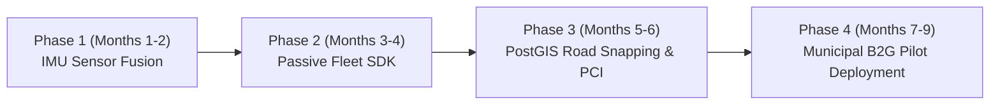

# RoadQuality: Commercialization, Sensor Fusion & Scaling Roadmap

---

## 1. Executive Summary

**RoadQuality** is an automated pavement distress monitoring and civic infrastructure management platform. While initial versions established computer vision-based pothole detection, spatial PostGIS indexing, and multi-persona governance, scaling to commercial deployment (B2G smart cities and B2B logistics) requires:

1. **Near-Zero False Positive Rates**: Transitioning from pure optical sensing to **multimodal sensor fusion** (Computer Vision + Smartphone IMU/Accelerometer).
2. **Automated Continuous Data Ingestion**: Shifting from active citizen interaction to **passive fleet telematics** mounted on municipal and delivery vehicles.
3. **Enterprise Spatial Analytics**: Moving from discrete incident pins to **street-segment-level Pavement Condition Index (PCI / ASTM D6433)** and predictive maintenance modeling.
4. **SaaS Commercialization**: Replacing cost-prohibitive LiDAR survey vans with high-frequency, low-cost municipal subscriptions and contractor escrow certification.

---

## 2. Multimodal Sensor Fusion (The Path to 99% Detection Accuracy)

### 2.1 The Visual-Only Limitation
Pure computer vision models suffer from environmental false positives:
* Dark shadows of trees, bridges, and buildings
* Fresh asphalt patches and localized slurry seals
* Surface oil and diesel stains
* Manhole covers, storm drains, and expansion joints
* Wet road reflections during and after rain

### 2.2 Computer Vision + IMU Accelerometer Fusion
Commercial-grade systems fuse optical frames with physical vehicle dynamics using device motion sensors (accelerometers and gyroscopes):

$$\text{Confidence}_{\text{Defect}} = w_{\text{CV}} \cdot P_{\text{Visual}}(\text{Distress}) + w_{\text{IMU}} \cdot f(Z_{\text{peak}}, \Delta \theta_{\text{pitch}})$$

* **Physical Verification**: When a vehicle drives over a genuine road depression or pothole, the vertical ($Z$-axis) accelerometer registers a characteristic sharp deceleration-acceleration waveform ($> 1.8\text{g}$).
* **False Positive Rejection**: If the camera predicts a pothole with high confidence but the $Z$-axis accelerometer detects $0.0\text{g}$ deviation, the optical anomaly is a surface discoloration or shadow—automatically discarding false reports before ingestion.
* **Speed Compensation**: Vehicle speed from GPS is normalized into the vibration calculation ($Z_{\text{norm}} = Z_{\text{raw}} / v_{\text{vehicle}}$).

```
[ Vehicle Camera Feed ] ───► [ YOLOv11 Edge Detector ] ──┐
                                                          ├─► [ Bayesian Sensor Fusion ] ──► Verified Incident
[ Smartphone IMU (Z-Axis) ] ─► [ Shockwave Peak Filter ] ──┘
```

### 2.3 Monocular Depth & Volume Estimation
* Integrate lightweight monocular depth models (e.g., Depth-Anything Small or Mobile-Depth) to generate relative depth maps from single camera snapshots.
* **Volume Calculation**:
  $$\text{Volume } (m^3) = \sum_{x, y \in \text{BBox}} \text{Depth}(x, y) \cdot \text{PixelArea}(x, y)$$
* **Automated Material Estimation**: Directly calculate the required tonnage of hot-mix asphalt (HMA), Reclaimed Asphalt Pavement (RAP), and bitumen tack coat required for repair work orders.

---

## 3. Passive Fleet Crowdsourcing Architecture

### 3.1 The Human Behavior Reality
Manual citizen reporting cannot guarantee comprehensive, systematic street coverage. Commercial viability requires **passive, background telemetry**.

### 3.2 Municipal Fleet Mounting (Public Buses & Sanitation Trucks)
* **High-Coverage Fleets**: Mount ruggedized smartphones or embedded dashcam units on:
  * Municipal solid waste collection trucks (traverse 100% of residential and arterial roads every 48–72 hours).
  * City transit buses (cover primary arterial corridors up to 20 times daily).
* **Autonomous Telematics Lifecycle**:
  1. Unit powers on automatically with vehicle ignition.
  2. Runs background video extraction and edge inference only when vehicle velocity exceeds $15\text{ km/h}$.
  3. Geo-tags detected defects with GPS, timestamp, and vehicle heading.
  4. Offloads compressed telemetry batches over municipal depot Wi-Fi at end-of-shift, eliminating high cellular data overheads.

### 3.3 B2B Commercial Fleet SDK
* Partner with last-mile logistics, delivery, and ride-hailing fleets.
* Provide a background telemetry SDK embedded in driver apps in exchange for driver fuel subsidies or municipal parking credits.

---

## 4. Enterprise Geospatial Intelligence (PostGIS & ASTM D6433)

### 4.1 Road Centerline Snapping
Municipal road contracts are awarded by street segments (e.g., *FC Road: Chhatrapati Sambhaji Bridge to Goodluck Chowk*), not individual potholes.

* **OpenStreetMap (OSM) / GIS Alignment**:
  * Snap raw GPS points to official road centerlines using PostGIS `ST_ClosestPoint` and `ST_Snap`.
  * Group coordinates into 100-meter structural road segments.

### 4.2 Automated Pavement Condition Index (PCI / SDI)
* Convert raw distress counts (potholes, longitudinal cracks, alligator cracking, rutting) into official international pavement metrics:
  * **ASTM D6433 Standard Practice for Roads and Parking Lots Pavement Condition Index** (0 to 100 scale).
  * **International Roughness Index (IRI)** calculated from continuous IMU elevation profiles.
* **GIS Layer Visualization**:
  * **Green (PCI 85–100)**: Sound / Good condition; routine maintenance.
  * **Yellow (PCI 60–84)**: Fair / Developing fatigue; scheduled slurry seal.
  * **Red (PCI 0–59)**: Critical / Structural failure; immediate milling and resurfacing tender.

### 4.3 Predictive Deterioration Modeling
* By combining historical defect frequency, traffic load volume, road surface age, and monsoon rainfall data, train a Markov transition model to forecast road failure curves:
  * Predict which road segments will deteriorate into severe potholes within the next 60–90 days.
  * **The Economic Value Proposition**: Preventive crack sealing costs **$2,000/km**, whereas emergency crater reconstruction after monsoon failure costs **$18,000/km**.

---

## 5. Commercialization, Business Models & Monetization

```
                               ┌────────────────────────────────────────────────────────┐
                               │       RoadQuality Municipal Platform Revenue           │
                               └──────────────────────────┬─────────────────────────────┘
                                                          │
          ┌───────────────────────────────────────────────┼───────────────────────────────────────────────┐
          │                                               │                                               │
          ▼                                               ▼                                               ▼
┌───────────────────┐                           ┌───────────────────┐                           ┌───────────────────┐
│     Tier 1:       │                           │     Tier 2:       │                           │     Tier 3:       │
│ Municipal B2G     │                           │ Contractor Escrow │                           │ B2B Fleet & Maps  │
│ SaaS Subscription │                           │ Quality Audit Fee │                           │ Telematics API    │
└───────────────────┘                           └───────────────────┘                           └───────────────────┘
```

### 5.1 Model A: Municipal B2G SaaS Subscription
* **Target**: Municipal Corporations (e.g., Pune Municipal Corporation, BMC, BBMP, Smart City SPVs, National Highways Authority).
* **Current Competitor Alternative**: Special-purpose LiDAR survey vans (costing ₹1,500–₹3,000 per kilometer per audit, performed only once every 1–2 years).
* **RoadQuality Value**: Continuous weekly road auditing at **₹150–₹250 per kilometer per month**.
* **Contract Structure**: Annual municipal software licensing based on total surveyed road network (e.g., ₹20,00,000–₹60,00,000 / year for a Tier-1 Indian city).

### 5.2 Model B: Contractor Quality Certification & Escrow
* **Target**: Civil construction contractors and road auditing consultants.
* **Mechanism**: Contractors submit mandatory "Milestone 3: Repaired Photo" audits through the platform.
* The system analyzes post-repair surface texture, leveling, and IRI roughness.
* Municipal payments are tied to the automated compliance certificate issued by the platform, guaranteeing contractor accountability.

### 5.3 Model C: B2B Telematics & Navigation API
* **Target**: Commercial delivery fleets, insurance providers, and navigation providers (Google Maps, MapMyIndia).
* **Data Product**: Real-time road hazard hazard feeds, severe crater warnings, and optimal routes that minimize vehicle chassis/suspension damage.

---

## 6. Edge AI Optimization & Edge Deployment

| Dimension | Prototype Phase | Production / Commercial Phase |
| :--- | :--- | :--- |
| **Model Format** | PyTorch / Python API Server | Quantized `INT8` ONNX Runtime Web / TFLite Edge |
| **Execution Hardware** | Server GPU / Cloud Server | Smartphone NPU (Neural Engine) via WebGPU |
| **Inference Latency** | 120 ms (server roundtrip) | 16–22 ms (native on-device 45+ FPS) |
| **Bandwidth Cost** | Streaming video to backend ($$$) | Zero bandwidth; only verified 50KB telemetry packets sent |
| **Offline Capability** | Fails without active 4G/5G | Fully operational offline; syncs when connectivity returns |

---

## 7. Phased Implementation Roadmap



### Phase 1: IMU Sensor Fusion (Months 1–2)
- [ ] Connect `devicemotion` / Web Sensor API to capture vertical acceleration ($Z$-axis G-force).
- [ ] Implement dual-threshold trigger: visual box + vibration spike.
- [ ] Reduce false positives by $> 90\%$ on uneven shadows and paint markings.

### Phase 2: Passive Fleet Telemetry (Months 3–4)
- [ ] Develop background vehicle dashcam mode for Android and iOS PWA.
- [ ] Implement auto-start / auto-stop based on GPS vehicle speed thresholds.
- [ ] Add depot Wi-Fi batch synchronization.

### Phase 3: Segment-Level PostGIS Analytics & ASTM PCI (Months 5–6)
- [ ] Ingest OpenStreetMap (OSM) Pune / Municipal road network shapefiles.
- [ ] Implement PostGIS `ST_Snap` to aggregate incident points into 100m street blocks.
- [ ] Generate automated Pavement Condition Index (PCI) and international roughness ratings.

### Phase 4: Municipal Pilot Deployment (Months 7–9)
- [ ] Pilot with 10 municipal utility / public transit vehicles on high-density corridors.
- [ ] Generate comparative audit against traditional manual road department inspections.
- [ ] Implement contractor tender escrow verification module for road repair certification.
